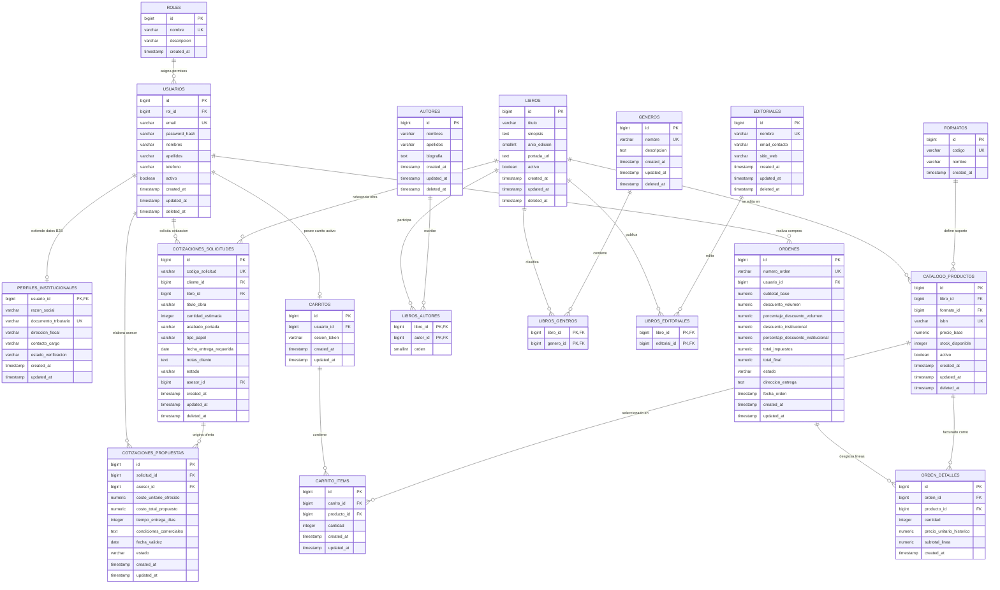

# Documento de Arquitectura y Diseño de Base de Datos
## Plataforma Web Editorial Multicanal (Patrón MVC)

### 1. Resumen de Arquitectura y Modelo Relacional
El sistema modela una **Plataforma Web Editorial Multicanal** orientada tanto al comercio minorista B2C como a transacciones institucionales y corporativas B2B (colegios, universidades, bibliotecas). La persistencia está diseñada sobre **PostgreSQL**, estructurada bajo la **Tercera Forma Normal (3FN)** con desnormalizaciones históricas controladas en transacciones financieras.

#### Módulos del Sistema:
1. **Seguridad y Control de Acceso Basado en Roles (RBAC - RF-02):**
   - `roles` (1:N) `usuarios`: Gobierna los 5 roles del sistema (*Visitante*, *Cliente Minorista*, *Cliente Institucional/Mayorista*, *Asesor de Ventas*, *Administrador*).
   - `usuarios` (1:1) `perfiles_institucionales`: Información fiscal, crediticia y de validación exclusiva para clientes mayoristas.
2. **Fondo Editorial y Catálogo Comercial (RF-01, RF-05.1):**
   - Desacoplamiento entre la **Obra Literaria** (`libros`) y la **Edición Comercial** (`catalogo_productos`). Una misma obra abstracta puede comercializarse en múltiples formatos (*Tapa blanda*, *Tapa dura*, *E-book*), cada una con su propio ISBN, precio base y stock.
   - Relaciones N:M mediante tablas intermedias puras con llaves primarias compuestas: `libros_autores`, `libros_generos`, `libros_editoriales`.
   - `formatos`: Catálogo normalizado de tipos de encuadernación/distribución.
3. **Ventas, Carrito y Órdenes de Compra (RF-03, RF-05.2):**
   - `carritos` (1:N) `carrito_items`: Persistencia de intención de compra por usuario autenticado o token de sesión.
   - `ordenes` (1:N) `orden_detalles`: Registro transaccional inmutable. Se desnormalizan campos monetarios (`subtotal_base`, `descuento_volumen`, `descuento_institucional`, `total_impuestos`, `precio_unitario_historico`) para blindar el balance contable histórico frente a fluctuaciones futuras del catálogo.
4. **Cotizaciones y Pedidos Personalizados (RF-04, RF-05.3):**
   - `cotizaciones_solicitudes`: Captura requerimientos a medida (tirajes masivos, tipo de papel, acabados) originados por Clientes Institucionales.
   - `cotizaciones_propuestas`: Respuestas formales emitidas por un Asesor de Ventas con precio cerrado, condiciones y vigencia.

---

### 2. Diagrama Entidad-Relación (Mermaid ERD)

---

### 3. Diccionario Conceptual y Reglas de Normalización

#### 3.1. Justificación de Normalización (3FN)
- **1FN:** Todos los atributos son atómicos (sin listas de autores ni arreglos de géneros en un solo campo).
- **2FN:** No existen dependencias funcionales parciales en tablas compuestas (`libros_autores`, `libros_generos`, `libros_editoriales`).
- **3FN:** No existen dependencias transitivas. El ISBN no depende de la obra general sino de su producto/formato específico; la razón social de empresas no se duplica en órdenes sino que reside en `perfiles_institucionales`.

#### 3.2. Desnormalizaciones Controladas (Justificadas)
- En `ordenes` y `orden_detalles`:
  - `precio_unitario_historico` y los montos monetarios calculados (`subtotal_base`, `descuento_volumen`, `descuento_institucional`, `total_impuestos`, `total_final`).
  - *Justificación Técnica:* Un cambio de precio en `catalogo_productos` o una modificación en la matriz de reglas de descuento en el Modelo jamás debe alterar el valor ni la factura de compras previamente cerradas.

---

### 4. Políticas de Integridad Referencial y Restricciones
- **Llaves primarias:** `bigint` autoincrementales (`BIGSERIAL` / `IDENTITY`) para alto volumen de lecturas y joins eficientes.
- **Borrado Lógico (Soft Delete):** Columnas `deleted_at TIMESTAMP NULL` en tablas maestras (`usuarios`, `libros`, `catalogo_productos`, `autores`, `editoriales`, `generos`). Las consultas del catálogo filtran automáticamente `WHERE deleted_at IS NULL`.
- **Políticas ON DELETE / ON UPDATE:**
  - Tablas pivote N:M (`libros_autores`, `libros_generos`, etc.): `ON DELETE CASCADE ON UPDATE CASCADE`.
  - Transacciones financieras y órdenes (`ordenes`, `orden_detalles`, `cotizaciones`): `ON DELETE RESTRICT` (prohibido eliminar registros con historial comercial).
  - Llaves foráneas a catálogos fijos (`formato_id`, `rol_id`): `ON DELETE RESTRICT`.

---

### 5. Estrategia de Índices y Rendimiento en PostgreSQL
1. **Búsqueda en tiempo real y catálogo (RF-01.2):**
   - Índice B-Tree compuesto en `catalogo_productos(libro_id, formato_id, activo)` donde `deleted_at IS NULL`.
   - Índice B-Tree en `catalogo_productos(isbn)`.
   - Índices B-Tree en `libros(titulo)` y `libros(anio_edicion)`.
   - Extensiones como `pg_trgm` (trigramas) en `libros(titulo)` y `autores(nombres, apellidos)` para búsquedas tipo `ILIKE '%query%'` sin escaneo secuencial.
2. **Consultas de pedidos y cotizaciones:**
   - Índice en `ordenes(usuario_id, estado, fecha_orden DESC)`.
   - Índice en `cotizaciones_solicitudes(cliente_id, estado)`.
   - Índice en `cotizaciones_solicitudes(asesor_id, estado)`.
3. **Control de concurrencia e inventario:**
   - Al procesar órdenes de compra, uso de `SELECT stock_disponible FROM catalogo_productos WHERE id = $1 FOR UPDATE` para evitar *race conditions* (sobreventa) en compras simultáneas.

---

### 6. Planificación de Datos Semilla (Seed Data - DML)
El requerimiento del Hackathon exige mínimo 10 libros, 5 usuarios con roles distintos y categorización inicial. Se estructuran de la siguiente manera:

1. **Roles del Sistema (5):**
   - `1: visitante`
   - `2: cliente_minorista`
   - `3: cliente_institucional`
   - `4: asesor_ventas`
   - `5: administrador`
2. **Usuarios de Prueba (5 cuentas con credenciales documentadas):**
   - `admin@editorial.com` (Rol: Administrador).
   - `asesor.comercial@editorial.com` (Rol: Asesor de Ventas).
   - `compras@colegiosanagustin.edu` (Rol: Cliente Institucional / Mayorista).
     - Perfil institucional asociado: *Colegio San Agustín*, RUC/NIT: *20549812345*.
   - `juan.perez@gmail.com` (Rol: Cliente Minorista).
   - `invitado@editorial.com` (Rol: Visitante / Cuenta de prueba para flujo no autenticado).
3. **Formatos (3):**
   - `tapa_blanda` ("Tapa Blanda / Rústica")
   - `tapa_dura` ("Tapa Dura / Cartoné")
   - `ebook` ("Edición Digital EPUB/PDF")
4. **Géneros Literarios (6):**
   - *Ficción Literaria*, *Ciencia Ficción*, *Historia y Ensayo*, *Tecnología y Software*, *Fantasía*, *Novela Policial*.
5. **Editoriales (4):**
   - *Editorial Minerva*, *Ágora Editores*, *Técnica Académica*, *Fondo Cultural Ibero*.
6. **Autores (8):**
   - Autores clásicos y técnicos representativos con nombres y biografías completas.
7. **Fondo Bibliográfico (10 Libros con 2 a 3 variantes comerciales cada uno):**
   - Libros técnicos (ej. *Patrones de Diseño de Software*, *Arquitectura Limpia*).
   - Clásicos universales y novelas.
   - Cada obra mapeada con sus géneros, autores y productos en catálogo con ISBNs de 13 dígitos válidos, precios calibrados para probar descuentos por volumen (1-5, 6-20, 21-50, >50 unidades) y stocks reales.
8. **Transacciones de Prueba:**
   - 2 carritos de prueba.
   - 2 órdenes cerradas con desglose de descuentos para validar la auditoría.
   - 2 solicitudes de cotización institucional con una de ellas ya respondida formalmente por el asesor.
